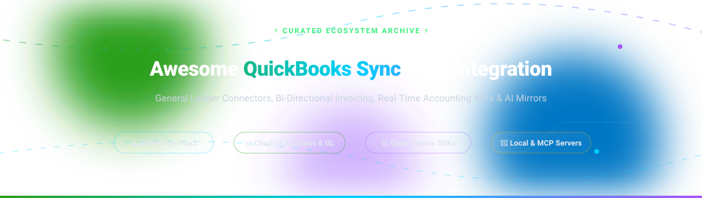

  

# ⚡ Awesome QuickBooks Sync & General Ledger (GL) Integration 📊

> **A comprehensive, SEO-optimized curated catalog of top QuickBooks Sync, Chart of Accounts, and General Ledger (GL) Integration platforms** — spanning leading enterprise SaaS/iPaaS connectors, billing-to-GL automation engines, and open-source developer SDKs, mirrors, and MCP servers.

---

## 📑 Table of Contents

- [🌐 Sector Overview & Market Dynamics](#-sector-overview--market-dynamics)
- [☁️ SaaS / Hosted Platforms](#️-saas--hosted-platforms)
- [💻 Open-Source Software & Developer Libraries](#-open-source-software--developer-libraries)
- [📊 Comparison Matrix at a Glance](#-comparison-matrix-at-a-glance)
- [🔍 Architectural Patterns: Bi-Directional vs. Local Mirror vs. iPaaS](#-architectural-patterns)
- [💖 Support & Sponsorship](#-support--sponsorship)
- [🌟 Star History](#--star-history)
- [🤝 Contributing](#-contributing)
- [📄 License](#-license)

---

## 🌐 Sector Overview & Market Dynamics

The global accounting integration and integrated financial management software market is estimated at **$21.4B–$23.1B in 2025** and projected to exceed **$25.0B by 2026** (growing at an ~8.5% CAGR), while the broader Integration Platform as a Service (iPaaS) market is expanding rapidly at an ~20–30% CAGR toward **$17B–$18B+**. 

The sector exhibits **moderate-to-high fragmentation at the integration tier**; while core ERP/accounting records are anchored by a few dominant platforms (Intuit QuickBooks, Oracle NetSuite, SAP, Xero), the integration and General Ledger middleware layer remains highly fragmented across hundreds of specialized vertical connectors, billing bridges, and workflow engines due to jurisdictional tax rules, diverse e-invoicing compliance mandates, and disparate payment gateways.

---

## ☁️ SaaS / Hosted Platforms

Commercial, cloud-hosted QuickBooks Sync and General Ledger Integration platforms sorted descending by company scale (valuation / annual recurring revenue).

| Platform | Primary Focus & Capabilities | Company Scale (Valuation / Revenue) | Starting Tier Pricing | Free Tier Limit / Free Trial Policy |
| :--- | :--- | :--- | :--- | :--- |
| **[Make (Celonis)](https://www.make.com/)** | Visual scenario automation with granular QuickBooks Online modules for bi-directional sync, custom webhooks, data transformation, and scheduled reconciliations. | **$13.0B valuation** (Parent Celonis) / €100M+ ARR | **$9.00 / month** (billed annually at $108/yr for Core Plan) or $10.59/mo monthly | **1,000 credits/month** free forever; capped at **2 active scenarios** and 15-minute minimum execution intervals. |
| **[Workato](https://www.workato.com/)** | Enterprise-grade iPaaS with pre-built QuickBooks recipes, bi-directional invoice and journal entry sync, corporate audit trails, and strict role-based governance. | **$5.7B valuation** (Series E benchmark) / ~$150M–$188M ARR | **$75.00 / month** (Pro Tier base self-serve); Enterprise custom tiers typically median ~$64,500/year | **One-time lifetime pool of 50,000 Workato credits** (free trial for test/prototype; does not renew monthly). |
| **[Zapier](https://www.zapier.com/)** | Multi-app workflow glue connecting QuickBooks Online with 7,000+ business applications; triggers on new bills, payments, and estimates. | **$5.0B valuation** (2021 secondary benchmark) / ~$300M+ ARR | **$19.99 / month** (billed annually at $239.88/yr for Professional) or $29.99/mo monthly | **100 tasks/month** free forever; restricted to **single 2-step Zaps** (1 trigger + 1 action) with 15-minute polling. |
| **[Chargebee](https://www.chargebee.com/)** | Subscription billing and revenue management engine featuring granular GL account mapping, sales tax handling, and invoice-to-QBO syncing. | **$3.5B valuation** (Series H) / ~$100M+ ARR | **$599.00 / month** (billed annually at $7,188/yr for Performance tier, includes $100K/mo MRR + 0.75% overage) | **Free for first $250,000 cumulative lifetime billing** on Starter plan (0.75% fee applies on volume over $250K). |
| **[Celigo](https://www.celigo.com/)** | iPaaS specializing in QuickBooks-to-NetSuite, CRM, and eCommerce sync with pre-packaged data flows for customers, items, orders, and GL entries. | **~$95M ARR** / ~$72M–$80M total venture funding raised | **$1,066.67 / month** (Standard tier entry ~**$12,800 / year** annual contract) | **1 active integration flow between 2 endpoints** free forever (unlimited flows during initial **30-day free trial**). |

---

## 💻 Open-Source Software & Developer Libraries

Community-driven, open-source QuickBooks sync libraries, local data mirrors, MCP servers, and self-hosted accounting suites sorted descending by GitHub Stars_Count.

| Project | Stack & Technology | License | GitHub_Stars | Architecture & Key Capabilities |
| :--- | :--- | :--- | :--- | :--- |
| **[Bigcapital](https://github.com/bigcapitalhq/bigcapital)** | TypeScript / Node.js / React | AGPL-3.0 |  | Full self-hosted double-entry financial accounting alternative with automated journal entries, invoicing, and reporting engines. |
| **[SlowBooks-Pro-2026](https://github.com/VonHoltenCodes/SlowBooks-Pro-2026)** | Python / Desktop GUI | Source-Available / MIT |  | Open-source standalone QuickBooks replacement decompiled from QBW32.EXE; provides double-entry GL, payroll, bank feeds, and multi-user server. |
| **[python-quickbooks](https://github.com/routablehq/python-quickbooks)** | Python | MIT |  | Comprehensive, battle-tested Python client wrapper for Intuit QuickBooks Online REST API v3 entities (Customers, Invoices, Accounts, Bills). |
| **[quickbooks-php](https://github.com/consolibyte/quickbooks-php)** | PHP | MIT |  | Veteran framework for integrating PHP applications with both QuickBooks Online and QuickBooks Desktop via Web Connector (SOAP/qbXML). |
| **[quickbooks-online-mcp-server](https://github.com/intuit/quickbooks-online-mcp-server)** | TypeScript / Node.js | MIT |  | Official Model Context Protocol (MCP) server enabling AI assistants (Claude, Cursor, Codex) to securely query and inspect QuickBooks Online data. |
| **[quickbooks-ruby](https://github.com/ruckus/quickbooks-ruby)** | Ruby | MIT |  | Ruby gem providing an object-oriented client interface to the Intuit QuickBooks Online REST API v3 with OAuth token lifecycle management. |
| **[node-quickbooks](https://github.com/mcohen01/node-quickbooks)** | JavaScript / Node.js | MIT |  | Node.js client module for interacting with Intuit's QuickBooks API supporting OAuth 1.0a / OAuth 2.0 and pagination helpers. |
| **[quickbooks-desktop-node](https://github.com/conductor-is/quickbooks-desktop-node)** | TypeScript / Node.js | MIT |  | Modern TypeScript library facilitating direct bidirectional communication with QuickBooks Desktop on Windows using qbXML over ActiveX/COM. |
| **[quickbooks-sync (.NET)](https://github.com/jsgoupil/quickbooks-sync)** | C# / .NET | MIT |  | High-performance C# server implementation that interacts with QuickBooks Desktop via Intuit Web Connector SOAP endpoints and ASP.NET. |
| **[LedgerSync](https://github.com/LedgerSync/ledger_sync)** | Ruby | MIT |  | Multi-platform accounting sync engine abstracting bi-directional resource synchronization across QuickBooks Online, NetSuite, and Xero. |
| **[local-books](https://github.com/ishandutta2007/Awesome-Quickbooks-Sync-GL-Integration)** | Bun / TypeScript / SQLite | MIT |  | Local, privacy-preserving SQLite replica and Change-Data-Capture (CDC) mirror for QuickBooks data with native MCP server support for local LLM tools. |

---

## 📊 Comparison Matrix at a Glance

| Software / Solution | License | Delivery Stack | Primary Sync Direction | GL / Chart of Accounts Mapping | Self-Hosted | Best For |
| :--- | :--- | :--- | :--- | :--- | :---: | :--- |
| **Make (Celonis)** | Proprietary | Cloud iPaaS | Bi-directional | ⚙️ Configurable via module logic | ❌ | Visual multi-step integrations with branching |
| **Workato** | Proprietary | Cloud Enterprise | Bi-directional | 🔒 Enterprise Recipe Mapping | ❌ | Large enterprises requiring SOC2 & governance |
| **Zapier** | Proprietary | Cloud iPaaS | Bi-directional | 🧩 Action/Trigger Mapping | ❌ | Quick, no-code integrations across 7,000+ apps |
| **Chargebee** | Proprietary | Cloud SaaS | Billing ➔ QBO | ✅ Granular GL Account Mapping | ❌ | Subscription billing with automated reconciliation |
| **Celigo** | Proprietary | Cloud iPaaS | Bi-directional | ✅ Pre-built NetSuite/QBO flows | ❌ | Mid-market ERP & eCommerce data integration |
| **Bigcapital** | Open Source | Node / React | Standalone / Sync | ✅ Full Native Double-Entry | ✅ | Open-source alternative to proprietary GLs |
| **SlowBooks-Pro** | Open Source | Python Desktop | Standalone | ✅ Native Double-Entry Engine | ✅ | Local offline desktop QuickBooks alternative |
| **python-quickbooks** | Open Source | Python | Client Wrapper | 🛠️ Programmatic via API | ✅ | Python backend integration developers |
| **intuit-mcp-server** | Open Source | Node / TypeScript | QBO ➔ MCP Tools | 🔍 Schema Inspection | ✅ | AI assistants needing real-time QBO data access |
| **LedgerSync** | Open Source | Ruby | Bi-directional | 📦 Multi-ledger resource models | ✅ | Ruby apps syncing across QBO and NetSuite |
| **local-books** | Open Source | Bun / SQLite | QBO ➔ Local Mirror | 📑 Normalized SQLite schema | ✅ | Privacy-first local AI agents querying GL data |

---

## 🔍 Architectural Patterns

When integrating external software with QuickBooks and General Ledgers, three dominant architectural archetypes emerge:

1. **Enterprise iPaaS & Workflow Orchestration (e.g., Make, Zapier, Celigo, Workato):**
   - *Strengths:* Pre-built visual builders, error retries, alerting, managed OAuth tokens.
   - *Trade-offs:* Per-operation or tier pricing scales quickly; requires continuous cloud egress of sensitive financial figures.
2. **Direct API Wrappers & Custom Sync Services (e.g., python-quickbooks, quickbooks-ruby, quickbooks-php):**
   - *Strengths:* Zero middleware licensing overhead; exact programmatic control over reconciliation edge cases, partial payments, and journal batches.
   - *Trade-offs:* Requires development and maintenance of rate-limiting queues, backoff algorithms, and token refresh machinery.
3. **Local Replica / Change-Data-Capture (CDC) & MCP Servers (e.g., local-books, intuit-mcp-server):**
   - *Strengths:* Keeps financial transaction histories on private infrastructure; empowers LLM agents (via Model Context Protocol) to generate financial reports and perform audits safely without leaking sensitive accounting entries.

---

## 💖 Support & Sponsorship

Thank you so much for exploring and using this curated resource! If you find this repository helpful for your accounting infrastructure, integrations, or developer tooling, please consider showing your support:

- ⭐ **Star this repository** to help others discover it
- 🍴 **Fork and contribute** new connectors, libraries, and tools
- 📢 **Share with your team**, colleagues, and developer communities
- ☕ **Buy me a coffee / Sponsor**: If you'd like to support ongoing curation and open-source maintenance, please consider sponsoring via the [GitHub Sponsors Dashboard](https://github.com/sponsors/ishandutta2007). Every bit of support is deeply appreciated!

---

##  Star History

---

## 🤝 Contributing

Contributions, issues, and feature additions are warmly welcome! If you know of an outstanding open-source tool, API wrapper, or enterprise sync platform for QuickBooks:

1. Fork this repository 🍴
2. Create your feature branch: `git checkout -b feature/add-new-connector`
3. Commit your changes: `git commit -m 'feat: Add Awesome-Connector'`
4. Push to the branch: `git push origin feature/add-new-connector`
5. Open a Pull Request 🚀

Please ensure your contribution includes the technology stack, license, primary architectural sync model, and a concise summary of capabilities.

---

## 📄 License

This repository and curated list are licensed under the **[Creative Commons Zero v1.0 Universal](LICENSE)** (Public Domain Dedication). All linked projects, trademarks, and logos belong to their respective copyright holders.

---

  Built with ❤️ for accounting engineers, fintech architects, and financial ops builders worldwide.

